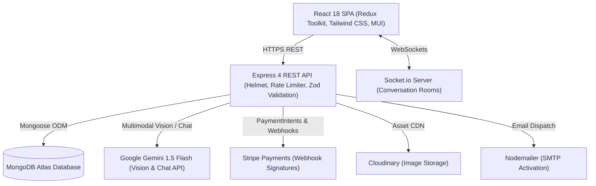

# Krushak

Full-stack agricultural marketplace connecting Indian farmers directly with buyers, featuring agricultural land leasing, real-time communication, and multimodal crop pathology diagnosis powered by Google Gemini.

[](https://github.com/Alok-Fusion/krushaksite/actions)
[](LICENSE)
[](https://nodejs.org)

**Live Demo**: [krushak.vercel.app](https://krushak.vercel.app) *(Deployment Link Placeholder)*  
**API Health**: [krushak-api.onrender.com/test](https://krushak-api.onrender.com/test)

---

## Architecture



---

## Features

### 1. Direct Agricultural Marketplace
- Direct farmer-to-buyer transactions eliminating middlemen fees.
- Granular search, category filtering (Pulses, Vegetables, Seeds, Fertilizers, Spices), price brackets, and paginated product catalogs.
- Farmer storefront management: inventory tracking, real-time sales revenue charts, and automated order fulfillment.

### 2. Agricultural Land Leasing & Sales
- Dedicated land listing portal for farmers to sell, lease, or rent agricultural acreage.
- Multi-parameter filtering by geographic location, acreage price, and lease status (Available, Leased, Sold).

### 3. AI Crop Disease Detection & Agronomy Assistant
- **Multimodal Leaf Pathology**: Farmers upload photos of diseased crops to receive instant diagnoses.
- **Structured Extraction**: Gemini 1.5 Flash returns validated JSON containing identified crop, disease diagnosis, confidence score, severity level, biological/environmental causes, treatment steps, and preventative farming practices.
- **Trilingual Accessibility**: Full diagnosis translation into English, Hindi (हिन्दी), and Marathi (मराठी).
- **Domain-Guarded Assistant**: "Krushak Krishi Mitra" conversational chatbot restricted strictly to agriculture, soil health, fertilizer ratios (NPK/DAP/Urea), monsoon precautions, and Indian government schemes (PM-KISAN).
- **Security & Safety**: 10MB file size cap, MIME-type verification, and strict rate limiting (`aiLimiter`).

### 4. Hindi & Marathi Voice Search
- **Browser Web Speech API**: Integrated voice search directly into the marketplace search bar with microphone permissions handling and active listening animations.
- **Trilingual Speech Recognition**: Dropdown selector supports Indian English (`en-IN`), Hindi (`hi-IN`), and Marathi (`mr-IN`). Unconditionally hides the microphone icon on unsupported browsers.
- **Gemini Query Normalization**: `POST /api/ai/normalize-query` takes natural language voice inputs (e.g., *"मुझे ताजा प्याज चाहिए"* or *"गव्हाचे बियाणे"*) and prompts Gemini 1.5 Flash to extract the canonical English search term (`onion`, `wheat`).
- **Resilient Fallback & Rate Limiting**: Capped at 200 characters, protected with `aiLimiter`, and automatically falls back to raw transcripts if Gemini is unreachable or unconfigured.

### 5. Mandi Price Forecaster (ML Service)
- **Time-Series Forecaster**: Standalone Python FastAPI microservice (`ml-service/`) projecting 7-day and 30-day commodity prices across 8 crops (*onion, tomato, potato, wheat, soybean, cotton, maize, tur*) and 6 Maharashtra APMCs (*Lasalgaon, Pune, Nashik, Nagpur, Kolhapur, Latur*).
- **Pluggable Data Interface**: `data_source.py` toggles via `DATA_SOURCE=synthetic|live`. Current phase uses a 2-year calibrated synthetic generator modeling harvest dips, off-season lean spikes, supply shocks, and inverse arrival elasticity. The live branch is stubbed for future Agmarknet (`data.gov.in`) ingestion without requiring downstream changes.
- **Feature Engineering & LightGBM**: Trained on lag features (1, 7, 14, 30 days), rolling means (7, 14, 30 days), and calendar variables on a strict time-based split (last 60 days holdout, never random).
- **Evaluation vs. Baselines (Synthetic Data)**:
  - *LightGBM*: **MAE = ₹66.01 / quintal**, **MAPE = 1.86%**
  - *Naive Baseline ($y_{t-1}$)*: **MAE = ₹53.35 / quintal**, **MAPE = 1.50%**
  - *7-Day Moving Average*: **MAE = ₹99.93 / quintal**, **MAPE = 2.90%**
  > **Note**: These numbers are evaluated strictly on synthetic simulation data and do not reflect real-world market accuracy. On single-step predictions, the naive baseline remains hard to beat in random-walk conditions, but LightGBM provides the autoregressive structure needed for 7-day and 30-day forward projections.
- **Frontend Dashboard**: Interactive Chart.js visualization with 90-day price history, forward projections, 95% shaded error margins, plain-language harvest marketing advice, demo data labeling, and trilingual labels (English, Hindi, Marathi).
- **Caching & Proxy**: Express backend proxies `GET /api/ai/forecast` with 5-minute in-memory caching and rate limiting.

### 6. Real-Time Chat System
- Socket.io room architecture (`joinConversation` / `leaveConversation`) isolating communications per conversation ID.
- Fallback user-to-user routing with live online indicators and typing timestamps.

### 7. Production Security & Financial Integrity
- **HTTP Hardening**: Helmet security headers, CORS origin whitelisting, and layered IP rate limiting (strictest on authentication and checkout).
- **Input Validation**: Schema validation using Zod on user, shop, product, order, and payment endpoints.
- **Role-Based Access Control**: Multi-role middleware partitioning user, seller, and admin permissions.
- **Server-Side Payment Verification**: Server-side verification with cryptographic Stripe webhook signature checks (`stripe.webhooks.constructEvent`).

---

## AI & ML Implementation Details

### Voice Query Normalization
Calls Gemini 1.5 Flash with JSON schema enforcement:
```json
{ "keyword": "onion" }
```

### Mandi Forecaster ML Metrics (from `metrics.json`)
```json
{
  "data_source": "synthetic",
  "split_strategy": "Time-based holdout (last 60 days)",
  "overall": {
    "lightgbm": { "mae": 66.01, "rmse": 135.37, "mape": 1.86 },
    "naive_last_value": { "mae": 53.35, "rmse": 120.54, "mape": 1.50 },
    "moving_average_7d": { "mae": 99.93, "rmse": 191.62, "mape": 2.90 },
    "beats_naive_baseline": false,
    "beats_ma7_baseline": true
  }
}
```


---

## Quickstart & Setup

### Prerequisites
- Node.js 18.x or 20.x
- MongoDB (local or MongoDB Atlas connection string)
- Git

### 1. Clone Repository
```bash
git clone https://github.com/Alok-Fusion/krushaksite.git
cd krushaksite
```

### 2. Environment Configuration
Copy `.env.example` in `backend/config/`:

```bash
cp backend/config/.env.example backend/config/.env
```

Fill in required keys:

| Variable | Description | Example |
| :--- | :--- | :--- |
| `PORT` | Backend server port | `8000` |
| `DB_URL` | MongoDB connection URI | `mongodb://localhost:27017/krushak` |
| `JWT_SECRET_KEY` | Secret for signing JWTs | *(random 64-char string)* |
| `ACTIVATION_SECRET` | Secret for email activation tokens | *(random string)* |
| `SMTP_HOST` | SMTP server host | `smtp.gmail.com` |
| `SMTP_PORT` | SMTP port | `465` |
| `SMTP_MAIL` | Sender email address | `krushak.org@gmail.com` |
| `SMTP_PASSWORD` | App password | `xxxx xxxx xxxx xxxx` |
| `STRIPE_API_KEY` | Stripe publishable key | `pk_test_...` |
| `STRIPE_SECRET_KEY` | Stripe secret key | `sk_test_...` |
| `STRIPE_WEBHOOK_SECRET`| Stripe webhook secret | `whsec_...` |
| `CLOUDINARY_NAME` | Cloudinary account name | `krushak` |
| `CLOUDINARY_API_KEY` | Cloudinary API key | `1234567890` |
| `CLOUDINARY_API_SECRET` | Cloudinary secret | `...` |
| `GEMINI_API_KEY` | Google AI Studio Gemini API key | `AIzaSy...` |
| `ML_SERVICE_URL` | Mandi Forecaster service URL | `http://localhost:8001` |
| `DATA_SOURCE` | Price data source (`synthetic` or `live`) | `synthetic` |
| `FRONTEND_URL` | Client origin | `http://localhost:3000` |
| `ALLOWED_ORIGINS` | Permitted CORS origins (comma-separated)| `http://localhost:3000,http://localhost:3001` |

### 3. Run with Docker Compose
```bash
docker compose up --build
```
This boots up:
- MongoDB at `localhost:27017`
- ML Forecaster Service at `localhost:8001`
- Backend API at `localhost:8000`
- Socket Server at `localhost:4000`
- Frontend at `localhost:3000`

### 4. Run Manually

**ML Service (Python 3.11):**
```bash
cd ml-service
pip install -r requirements.txt
python scripts/generate_synthetic.py
python train.py
uvicorn main:app --host 0.0.0.0 --port 8001
```

**Backend (Node/Express):**
```bash
cd backend
npm install
npm run dev
```

**Socket Server:**
```bash
cd socket
npm install
node index.js
```

**Frontend (React):**
```bash
cd frontend
npm install
npm start
```

---

## Testing & CI

### Backend Unit & Integration Tests (Jest + Supertest)
```bash
cd backend
npm test
```
Covers authentication, order handling, Stripe webhooks, Gemini voice query normalization (`/api/ai/normalize-query`), and ML forecast proxy caching and validation (`/api/ai/forecast`).

### ML Forecaster Tests (pytest)
```bash
cd ml-service
pytest
```
Covers synthetic dataset generator schema, seed reproducibility, feature engineering lags and rolling windows, and FastAPI forecast endpoints.

GitHub Actions automatically runs the test suite on every pull request and push to `main`:
See workflow configuration in [`.github/workflows/ci.yml`](.github/workflows/ci.yml).

---

## Multilingual Support (English, Hindi, Marathi)

Krushak provides full-stack multilingual localization across Indian English (`en`), Hindi (`hi`), and Marathi (`mr`).

### 1. UI Translation Architecture
- **Framework**: Built with `i18next`, `react-i18next`, and `i18next-browser-languagedetector`.
- **Namespaces**: Organized in `frontend/src/i18n/{en,hi,mr}.json` across 10 namespaces: `common`, `nav`, `auth`, `shop`, `products`, `cart`, `checkout`, `admin`, `guide`, `pricetrends`.
- **Language Switcher**: Prominently accessible in the main consumer header, mobile drawer, seller dashboard header, and admin header. Persists in `localStorage` (`krushak_language`), defaults to browser language, falls back to English, and dynamically updates `<html lang="...">`.
- **Typography & Layout**: Automatically loads Google Font **Noto Sans Devanagari** for Hindi and Marathi script rendering, with responsive layout overflow protections across navbar items, buttons, cards, and tables.
- **Localization Formatters**: Localized currency, numbers, and dates via `Intl.NumberFormat` and `Intl.DateTimeFormat` (`en-IN`, `hi-IN`, `mr-IN`) in `frontend/src/utils/formatters.js`.
- **Key Parity Audit**: Verified in CI with `node scripts/check-i18n.js` ensuring zero missing keys across English, Hindi, and Marathi dictionaries.

### 2. User-Generated Content Translation Architecture
- **Model Schemas**: `Product`, `Lands`, `Shop`, and embedded `reviews` schemas include:
  - `translations: { en: Object, hi: Object, mr: Object }` holding translatable fields only.
  - `sourceLang`: Original language of creation (`en` | `hi` | `mr`).
  - `sourceHash`: Cryptographic SHA-256 hash of translatable fields.
  - `edited: { en: Boolean, hi: Boolean, mr: Boolean }`: Protects manually curated translations.
- **Gemini Translation Service (`backend/utils/translate.js`)**:
  - Prompts Google Gemini 1.5 Flash strictly as data translation.
  - Preserves brand names (e.g. *Bayer*, *IFFCO*, *UPL*, *Mahyco*), variety names (*Pusa Basmati*, *Sharbati*), numbers, units (kg, quintal, acre, guntha, hectare), and currency amounts (₹, Rs).
  - Uses domain agricultural terms strictly conforming to `backend/utils/glossary.json`.
  - JSON schema enforcement, single-retry resilience, and graceful fallback to original text.
- **Background In-Process Queue (`backend/utils/translationQueue.js`)**:
  - Automatically enqueues documents on create and update.
  - Skips translation if `sourceHash` is unchanged or if target language has `edited: true`.
- **Localized Content API**:
  - `GET` endpoints for products, lands, shops, and reviews accept `?lang=en|hi|mr` (or `Accept-Language` header) and overlay translated text onto standard field names (`name`, `description`), preserving response shapes and providing `isTranslated`, `translatedFrom`, and `original` objects.
  - Search queries match against both canonical and translated fields in all three languages.
- **Owner Translation Customization**:
  - `PUT /api/translations/:model/:id/:lang`: Allows document owners (verified via JWT authentication and seller ownership checks) to edit translations and marks `edited = true`.
- **On-Demand Chat Message Translation**:
  - `POST /api/ai/translate-message`: Translates chat messages on demand with length capped at 1000 characters, protected by `aiLimiter`, and backed by an in-memory cache keyed by message ID and target language.
- **Frontend Attribution & Review**:
  - Displays `"Translated from {{language}}"` attribution badge with an instant `"Show original"` / `"Show translation"` toggle.
  - Sellers have a collapsed **Multilingual Translations** section in listing creation/editing forms for preview and manual review.

### 3. Agricultural Glossary Location
- Terminology mappings are stored in [`backend/utils/glossary.json`](backend/utils/glossary.json).
- Contains vetted agricultural translations for commodities (seeds, fertilizer, urea, DAP, potash, mandi, quintal, kharif, rabi, acreage, soil types).

### 4. How to Add a New Language (e.g., Gujarati or Telugu)
1. Add the language code (e.g. `gu` or `te`) to `backend/utils/glossary.json` with domain terminology.
2. Add translation file `frontend/src/i18n/gu.json` matching all keys in `en.json`.
3. Register the new language in `frontend/src/i18n/i18n.js` and `frontend/src/components/Layout/LanguageSwitcher.jsx`.
4. Add the language key to model schemas (`translations: { en, hi, mr, gu }` and `edited: { en, hi, mr, gu }`).
5. Run `node scripts/check-i18n.js` to verify dictionary parity.

### 5. Running the Translations Backfill Script
To populate translations for existing database listings:
```bash
node scripts/backfill-translations.js
```
The backfill script is **idempotent**, **rate-limited** (600ms delay between Gemini API calls), and **resumable** (tracks completed IDs in `scripts/.backfill-checkpoint.json`).

> [!IMPORTANT]
> **Native Speaker Review Disclaimer**: Machine-generated translations produced by Gemini AI provide strong semantic coverage, but dialectical and regional agricultural nuances vary across states. High-impact public listings should be reviewed by a native Hindi/Marathi speaker before commercial publication.

---

## Deployment Guide

- **Frontend (Vercel)**: Configured with [`frontend/vercel.json`](frontend/vercel.json) to handle single-page routing without 404s.
- **Backend (Render / Railway)**: Configured with [`render.yaml`](render.yaml) and [`railway.json`](railway.json). Set `ML_SERVICE_URL` to point to the deployed ML service.
- **ML Service Deployment**:
  - **Render (Docker / Web Service)**:
    1. Create a new Web Service from the repository with Root Directory set to `ml-service`.
    2. Choose **Docker** runtime (it uses `ml-service/Dockerfile`).
    3. Set environment variable `DATA_SOURCE=synthetic` (or `live` once Agmarknet credentials are configured).
    4. Provide the public Render URL (`https://<ml-service-name>.onrender.com`) to the backend's `ML_SERVICE_URL` variable.
  - **Hugging Face Spaces (Docker / FastAPI)**:
    1. Create a new Space with the **Docker** SDK.
    2. Set `ml-service/` as repository root or link the repo.
    3. Expose port `8001` or set `PORT=7860` for Hugging Face standard port binding.
    4. Copy the direct Space URL into the Express backend's `ML_SERVICE_URL`.
- **Database**: MongoDB Atlas M0/M10 cluster with IP access list and user role authentication.

---

## Screenshots

<div align="center">
  
  
  
  
  
  
</div>

---

## License

Distributed under the ISC License. See [LICENSE](LICENSE) for details.
