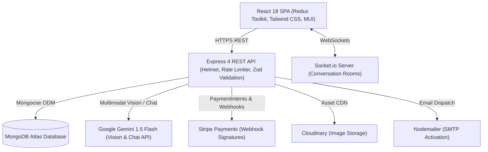

# Krushak

Full-stack agricultural marketplace connecting Indian farmers directly with buyers, featuring agricultural land leasing, real-time communication, and multimodal crop pathology diagnosis powered by Google Gemini.

[](https://github.com/Alok-Fusion/krushaksite/actions)
[](LICENSE)
[](https://nodejs.org)

**Live Demo**: [krushak.vercel.app](https://krushak.vercel.app) *(Deployment Link Placeholder)*  
**API Health**: [krushak-api.onrender.com/test](https://krushak-api.onrender.com/test)

---

## Architecture



---

## Features

### 1. Direct Agricultural Marketplace
- Direct farmer-to-buyer transactions eliminating middlemen fees.
- Granular search, category filtering (Pulses, Vegetables, Seeds, Fertilizers, Spices), price brackets, and paginated product catalogs.
- Farmer storefront management: inventory tracking, real-time sales revenue charts, and automated order fulfillment.

### 2. Agricultural Land Leasing & Sales
- Dedicated land listing portal for farmers to sell, lease, or rent agricultural acreage.
- Multi-parameter filtering by geographic location, acreage price, and lease status (Available, Leased, Sold).

### 3. AI Crop Disease Detection & Agronomy Assistant
- **Multimodal Leaf Pathology**: Farmers upload photos of diseased crops to receive instant diagnoses.
- **Structured Extraction**: Gemini 1.5 Flash returns validated JSON containing identified crop, disease diagnosis, confidence score, severity level, biological/environmental causes, treatment steps, and preventative farming practices.
- **Trilingual Accessibility**: Full diagnosis translation into English, Hindi (हिन्दी), and Marathi (मराठी).
- **Domain-Guarded Assistant**: "Krushak Krishi Mitra" conversational chatbot restricted strictly to agriculture, soil health, fertilizer ratios (NPK/DAP/Urea), monsoon precautions, and Indian government schemes (PM-KISAN).
- **Security & Safety**: 10MB file size cap, MIME-type verification, and strict rate limiting (`aiLimiter`).

### 4. Real-Time Chat System
- Socket.io room architecture (`joinConversation` / `leaveConversation`) isolating communications per conversation ID.
- Fallback user-to-user routing with live online indicators and typing timestamps.

### 5. Production Security & Financial Integrity
- **HTTP Hardening**: Helmet security headers, CORS origin whitelisting, and layered IP rate limiting (strictest on authentication and checkout).
- **Input Validation**: Schema validation using Zod on user, shop, product, order, and payment endpoints.
- **Role-Based Access Control**: Multi-role middleware partitioning user, seller, and admin permissions.
- **Server-Side Payment Verification**: Server-side verification with cryptographic Stripe webhook signature checks (`stripe.webhooks.constructEvent`).

---

## AI Implementation Details

The crop disease engine uses Google's `gemini-1.5-flash` model with schema enforcement:

```javascript
// backend/controller/ai.js
const model = genAI.getGenerativeModel({
  model: "gemini-1.5-flash",
  generationConfig: {
    responseMimeType: "application/json",
    temperature: 0.2,
  },
});
```

The output payload is validated before client delivery:

```json
{
  "crop": "Tomato",
  "disease": "Early Blight (Alternaria solani)",
  "confidence": "94%",
  "severity": "Moderate",
  "causes": ["Alternaria solani fungal spores", "High humidity and overhead irrigation"],
  "treatment": ["Apply copper-based fungicide at 2.5g/L water", "Prune diseased lower foliage"],
  "prevention": ["Adopt drip irrigation", "2-year crop rotation with non-solanaceous crops"]
}
```

---

## Quickstart & Setup

### Prerequisites
- Node.js 18.x or 20.x
- MongoDB (local or MongoDB Atlas connection string)
- Git

### 1. Clone Repository
```bash
git clone https://github.com/Alok-Fusion/krushaksite.git
cd krushaksite
```

### 2. Environment Configuration
Copy `.env.example` in `backend/config/`:

```bash
cp backend/config/.env.example backend/config/.env
```

Fill in required keys:

| Variable | Description | Example |
| :--- | :--- | :--- |
| `PORT` | Backend server port | `8000` |
| `DB_URL` | MongoDB connection URI | `mongodb://localhost:27017/krushak` |
| `JWT_SECRET_KEY` | Secret for signing JWTs | *(random 64-char string)* |
| `ACTIVATION_SECRET` | Secret for email activation tokens | *(random string)* |
| `SMTP_HOST` | SMTP server host | `smtp.gmail.com` |
| `SMTP_PORT` | SMTP port | `465` |
| `SMTP_MAIL` | Sender email address | `krushak.org@gmail.com` |
| `SMTP_PASSWORD` | App password | `xxxx xxxx xxxx xxxx` |
| `STRIPE_API_KEY` | Stripe publishable key | `pk_test_...` |
| `STRIPE_SECRET_KEY` | Stripe secret key | `sk_test_...` |
| `STRIPE_WEBHOOK_SECRET`| Stripe webhook secret | `whsec_...` |
| `CLOUDINARY_NAME` | Cloudinary account name | `krushak` |
| `CLOUDINARY_API_KEY` | Cloudinary API key | `1234567890` |
| `CLOUDINARY_API_SECRET` | Cloudinary secret | `...` |
| `GEMINI_API_KEY` | Google AI Studio Gemini API key | `AIzaSy...` |
| `FRONTEND_URL` | Client origin | `http://localhost:3000` |
| `ALLOWED_ORIGINS` | Permitted CORS origins (comma-separated)| `http://localhost:3000,http://localhost:3001` |

### 3. Run with Docker Compose
```bash
docker compose up --build
```
This boots up:
- MongoDB at `localhost:27017`
- Backend API at `localhost:8000`
- Socket Server at `localhost:4000`
- Frontend at `localhost:3000`

### 4. Run Manually

**Backend:**
```bash
cd backend
npm install
npm run dev
```

**Socket Server:**
```bash
cd socket
npm install
node index.js
```

**Frontend:**
```bash
cd frontend
npm install
npm start
```

---

## Testing & CI

The backend test suite is built with Jest and Supertest, covering auth, query filtering, pagination, order creation, Stripe webhooks, and AI image validation:

```bash
cd backend
npm test
```

GitHub Actions automatically runs the test suite on every pull request and push to `main`:
See workflow configuration in [`.github/workflows/ci.yml`](.github/workflows/ci.yml).

---

## Deployment

- **Frontend (Vercel)**: Configured with [`frontend/vercel.json`](frontend/vercel.json) to handle single-page routing without 404s.
- **Backend (Render / Railway)**: Configured with [`render.yaml`](render.yaml) and [`railway.json`](railway.json).
- **Database**: MongoDB Atlas M0/M10 cluster with IP access list and user role authentication.

---

## Screenshots

<div align="center">
  
  
  
  
  
  
</div>

---

## License

Distributed under the ISC License. See [LICENSE](LICENSE) for details.
